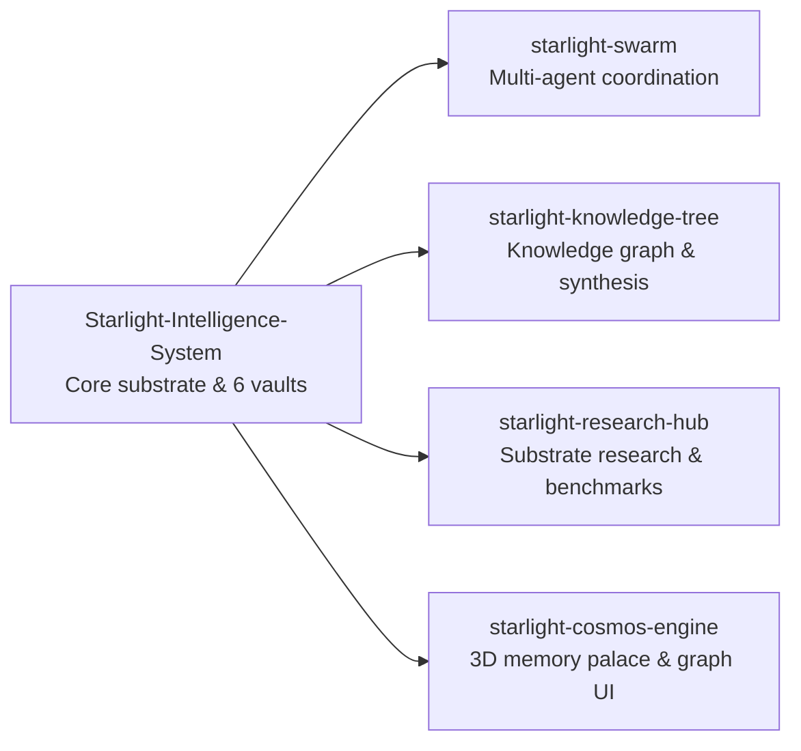

# Starlight Intelligence Systems

Sovereign substrate, Starlight Intelligence Protocol (SIP), multi-vault memory architecture, and open research.

**Website:** [starlightintelligence.org](https://starlightintelligence.org) · **Ecosystem:** [Starlight Intelligence](https://github.com/Starlight-Intelligence) · [Starlight Systems](https://github.com/Starlight-Intelligence-Systems) · [Arcanea Labs](https://github.com/Arcanea-Labs) · [GenCreator](https://github.com/GenCreator-ai) · [FrankX](https://github.com/FrankX-AI)

---

## Overview

Starlight Intelligence Systems maintains the open Starlight Intelligence Protocol (SIP) substrate, the six-vault cognitive memory engine, multi-agent swarm coordination primitives, and public research specifications.

## System topology



## Flagship repositories

| Repository | Purpose | Link |
| :--- | :--- | :--- |
| [**Starlight-Intelligence-System**](https://github.com/Starlight-Intelligence-Systems/Starlight-Intelligence-System) | Shared cognitive substrate for AI fleets: six typed memory vaults, hybrid FTS5 recall, and 151 specialist agent profiles. | [Website](https://starlightintelligence.org) |
| [**starlight-swarm**](https://github.com/Starlight-Intelligence-Systems/starlight-swarm) | Swarm coordination substrate for heterogeneous frontier agent harnesses. | [Website](https://starlightintelligence.org) |
| [**starlight-knowledge-tree**](https://github.com/Starlight-Intelligence-Systems/starlight-knowledge-tree) | Structured knowledge-graph engine with source provenance and automated synthesis. | [Website](https://starlightintelligence.org) |
| [**starlight-research-hub**](https://github.com/Starlight-Intelligence-Systems/starlight-research-hub) | Public substrate research, memory architecture benchmarks, and multi-agent synthesis. | [Website](https://starlightintelligence.org/research) |
| [**starlight-cosmos-engine**](https://github.com/Starlight-Intelligence-Systems/starlight-cosmos-engine) | Interactive 3D spatial memory palace and knowledge topology visualizer. | [Website](https://starlightintelligence.org) |

## Quickstart

```bash
# Initialize a Starlight Intelligence System workspace
npx @starlight-intelligence/sis@latest init

# Clone the reference substrate
git clone https://github.com/Starlight-Intelligence-Systems/Starlight-Intelligence-System.git
cd Starlight-Intelligence-System && npm test
```

## Engineering standards

Every repository in **Starlight Intelligence Systems** follows the Starlight estate engineering contract:

1. **Draft-first pull requests**: Open pull requests in draft mode (`gh pr create --draft`). CI workflows run only when a pull request is marked ready for review or lands on `main`.
2. **Independent verification**: Maker harness and Checker harness must differ (`Maker-Harness` != `Checker-Harness`).
3. **Zero committed secrets**: Credentials live in local environment files or Infisical. Pre-commit and CI gates reject secret patterns.
4. **Editorial clarity**: Public documentation uses sentence case headings, concrete verbs, and verified metrics.

---

<sub>Maintained by <a href="https://github.com/frankxai">Frank Riemer (frankxai)</a> · Built on the <a href="https://github.com/Starlight-Intelligence-Systems/Starlight-Intelligence-System">Starlight Intelligence Protocol (SIP)</a></sub>
